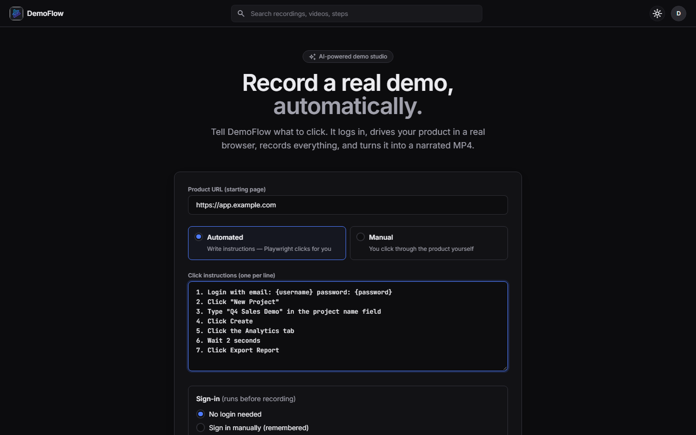
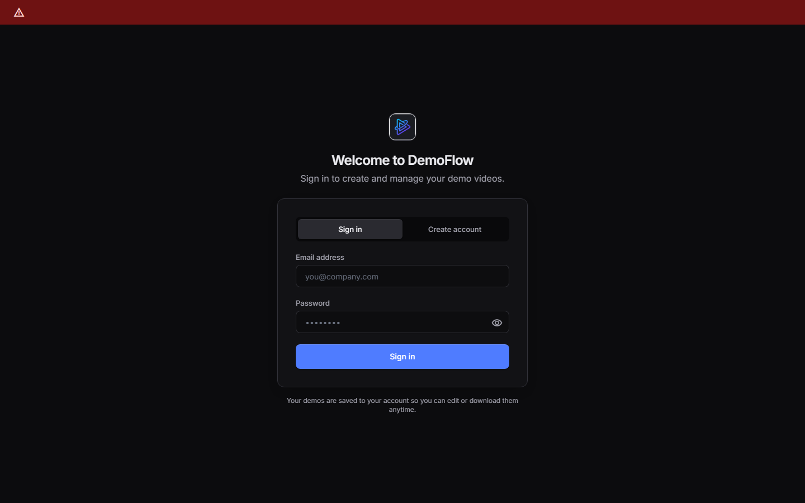

# DemoFlow

Tell DemoFlow what to click. It logs into your product, drives a real browser step by step while recording, has Gemini watch the recording and write narration, overlays highlights/zooms/title cards with FFmpeg, adds a TTS voiceover, and exports a polished demo MP4.



**Highlights**

- **Agentic browser automation.** Gemini turns plain-English steps into Playwright actions. When a selector fails, it falls back to role, then visible text, then a **vision-based click** on a screenshot.
- **AI video understanding.** Gemini Vision watches the recording, splits it into steps, writes the narration and places the highlights.
- **Video pipeline.** FFmpeg zoom, spotlight and ripple effects, title cards and crossfades, with a per-step TTS voiceover. Rendering runs with limited concurrency and can be cancelled.
- **Editor UI.** Review and edit the steps and scripts, regenerate narration in a different tone, insert steps, then render.
- **Works without an API key.** Every AI step has a deterministic fallback.
- **Stack:** Python · FastAPI · Playwright · Google Gemini · FFmpeg · SQLite · vanilla JS + Tailwind. Progress streams to the browser over Server-Sent Events (SSE).

## The flow

```
URL + login + natural-language click instructions
  → Gemini parses instructions into Playwright actions   (instruction_parser)
  → Playwright logs in & executes clicks WHILE recording  (browser_recorder)
  → Gemini Vision analyzes the recording → steps + scripts (vision_analyzer)
  → You edit steps/scripts in the editor UI
  → FFmpeg overlays highlights/zoom/spotlight/titles      (annotator)
  → TTS voiceover merged per step                         (tts_service, video_composer)
  → Intro card + crossfade assembly → final-demo.mp4      (assembler)
```

## Prerequisites

| Requirement | Install |
|---|---|
| Python 3.11+ | https://python.org |
| FFmpeg + ffprobe | `winget install ffmpeg` / `brew install ffmpeg` / `apt install ffmpeg` |
| Gemini API key | https://aistudio.google.com/apikey |

## Setup & run

```sh
cd backend
pip install -r requirements.txt
playwright install chromium
cd ..
copy .env.example .env        # then add GEMINI_API_KEY
cd backend
uvicorn main:app --reload --port 8000
```

Open **http://localhost:8000** — the backend serves the frontend.

Without a `GEMINI_API_KEY` the app still works in fallback mode: instructions are parsed with a deterministic parser (numbered format below), steps are derived from the recorded action timeline, and narration uses template text. Add the key for AI-quality parsing, scripts, and highlight placement.

## Writing instructions

One action per line, plain English:

```
1. Login with email: demo@company.com password: demopass123
2. Click "New Project"
3. Type "Q4 Sales Demo" in the project name field
4. Click Create
5. Click the Analytics tab
6. Wait 2 seconds
7. Click Export Report
```

## Authentication options

| Method | How it works |
|---|---|
| **Credentials** | You provide username/password; Playwright fills the login form. Use `{username}` / `{password}` placeholders in instructions. |
| **Cookie string** | Paste cookies from DevTools; injected before navigation. |
| **Auth token** | Sent as `Authorization: Bearer …` header. |
| **Persistent session** | Each flow uses a persistent browser profile (`output/sessions/{flowId}`), so a manual login during one recording is remembered for re-runs. |

The recording browser is **visible by default** (`HEADLESS=false`) so you can watch the automation — and intervene manually if a step needs a human (e.g., a captcha).

## API reference

| Endpoint | Purpose |
|---|---|
| `POST /api/record` | `{url, instructions, auth}` → `202 {flow_id}`; runs parse → record → analyze in the background |
| `GET /api/progress/{flow_id}` | SSE progress stream (`{stage, message, percent}`) |
| `GET /api/flow/{flow_id}` | Current flow JSON |
| `PATCH /api/flow/{flow_id}` | Save edited steps/scripts |
| `POST /api/generate` | Annotate + narrate + compose all step clips (concurrency 2) |
| `POST /api/render` | Intro card + crossfade assembly → `{output_video_path}` |
| `POST /api/regenerate-script` | Gemini rewrite of one step's narration |
| `POST /api/cancel/{flow_id}` | Cancel a running generate/render job |
| `GET /api/output/{flow_id}/final-demo.mp4` | Download the final video |
| `GET /api/output/{flow_id}/frame/{filename}` | Step frame thumbnails |
| `GET /api/health` | FFmpeg/Gemini/TTS status |

## Error handling

- **FFmpeg missing** → startup error in terminal + warning banner in the UI.
- **Action fails** (element not found) → tries CSS selector, role, visible text, then a Gemini Vision screenshot-based click; if all fail, the step is logged to `errors.log` and the recording continues.
- **Gemini invalid JSON** → one stricter retry, then deterministic fallback.
- **TTS failure** → narration burned in as subtitles instead.
- Everything appends to `output/{flow_id}/errors.log` with timestamps + tracebacks.

## Project structure

```
demoflow/
├── backend/
│   ├── main.py                    # FastAPI app + static frontend serving
│   ├── requirements.txt
│   ├── api/                       # record, flow, generate, render, script, progress (SSE)
│   ├── services/
│   │   ├── instruction_parser.py  # NL instructions → Playwright actions (Gemini + fallback)
│   │   ├── browser_recorder.py    # login + clicks + video recording (Mode A)
│   │   ├── vision_analyzer.py     # recording → steps + narration scripts
│   │   ├── annotator.py           # FFmpeg highlight/zoom/spotlight/ripple/title filters
│   │   ├── tts_service.py         # Google TTS → pyttsx3 → subtitles
│   │   ├── video_composer.py      # per-step clip + voiceover (semaphore 2)
│   │   ├── assembler.py           # intro card + xfade/acrossfade concat
│   │   ├── gemini.py              # Gemini wrapper + JSON extraction
│   │   └── ffmpeg.py              # async ffmpeg/ffprobe helpers
│   ├── core/                      # config (pydantic-settings), storage, SSE progress bus
│   └── models/flow.py             # Pydantic models
├── frontend/index.html            # vanilla JS, 3 views (input / progress / editor)
├── client/                        # legacy React prototype (design reference, not wired up)
└── output/                        # recordings, frames, clips, final MP4s (gitignored)
```

## GCP migration path

| Component | Local | On GCP |
|---|---|---|
| Gemini calls | `google-generativeai` + API key | Vertex AI SDK, same models |
| TTS | REST key / pyttsx3 | `google-cloud-texttospeech` client |
| Recorder | local Chromium | Cloud Run (Playwright image) |
| Rendering | local FFmpeg | Cloud Run Jobs, MP4 → GCS signed URLs |
| Progress bus | in-memory | Pub/Sub or Firestore listeners |
| Storage | `./output/` | GCS bucket, same key layout |

## Screenshots

| Sign in | New demo |
|---|---|
|  |  |
